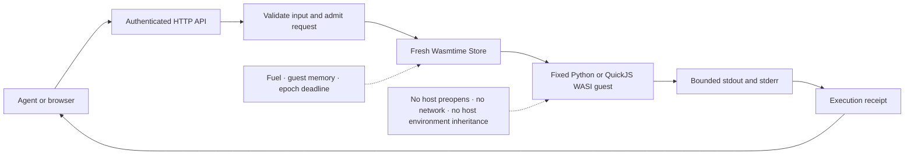

# SandboxRun

Run agent-generated Python and JavaScript in fixed WebAssembly interpreters, with explicit resource budgets and an execution receipt. Rust + Wasmtime at the execution boundary; HTTP and TypeScript interfaces for agent builders.

SandboxRun is a preview for small, ephemeral calculations and transformations. It does not offer a production SLA or claim immunity to runtime vulnerabilities.


## Execution model



The build script verifies the pinned interpreter hashes and precompiles them for the target platform. The service loads only these trusted, embedded compiled modules and instantiates a fresh guest for each request. It also verifies the packaged interpreter artifacts at startup. It does not compile user-provided Wasm or execute submitted source through native host Python or Node.js. Source, stdin, and guest output are not intentionally logged or saved as execution history.

## Run locally

Prerequisites: the Rust toolchain pinned in `rust-toolchain.toml`, a supported native build environment, and Node.js 20+ for the SDK tests. The checked-in Wasm artifacts are verified against hashes by the runtime before loading.

```sh
git clone https://github.com/SayedZahur786/SandboxRun.git
cd SandboxRun
cargo build --release --locked
export SANDBOXRUN_API_KEY="$(openssl rand -hex 32)"
cargo run --release --locked --bin sandboxrun-server
```

Open [the local workbench](http://127.0.0.1:18787). Enter the API key you generated into the workbench; it stays in the page’s memory and is not persisted in browser storage. The server binds to loopback on port 18787 and requires a key of at least 32 characters. Run commands from the repository root so the service can locate `runtimes/` and `web/`.

In a second terminal, use the same key through `SANDBOXRUN_API_KEY`:

```sh
curl http://127.0.0.1:18787/api/run \
  -H "Authorization: Bearer $SANDBOXRUN_API_KEY" \
  -H "Content-Type: application/json" \
  -d '{"language":"python","code":"print(6 * 7)","limits":{"wall_time_ms":2000}}'
```

This executes a calculation and returns a JSON receipt. Receipt identifiers, timings, and fuel usage come from the actual run; they are not fixed example values.

## HTTP contract

| Endpoint | Behavior |
| --- | --- |
| `POST /api/run` | Authenticated source execution; alias: `/v1/execute` |
| `GET /api/capabilities` | Runtime identities, defaults, maximums, and capability policy; alias: `/v1/capabilities` |
| `GET /api/health` | Service readiness |
| `POST /api/events` | Allowlisted `page_view` or `run_clicked` event only |

A request contains `language` (`python` or `javascript`), `code`, optional `stdin`, and optional `limits`. Unknown fields are rejected. Source and stdin are each limited to 65,536 UTF-8 bytes; the HTTP body also has a 150,000-byte ceiling, including JSON encoding overhead.

| Limit | Default | Accepted range | Meaning |
| --- | ---: | ---: | --- |
| `fuel` | 2,000,000,000 | 1–5,000,000,000 | Wasmtime computational fuel, not CPU milliseconds |
| `memory_bytes` | 134,217,728 | 16,777,216–268,435,456 | Guest linear memory, not whole-process memory |
| `wall_time_ms` | 2,000 | 1–5,000 | Guest execution deadline, subject to epoch/scheduling granularity |
| `output_bytes` | 16,384 | 1–65,536 | Ceiling for each output stream |

A low accepted memory budget may be insufficient to instantiate an interpreter. The CPU budget includes interpreter work. Network transit and service initialization are separate from execution duration. Interpreter compilation happens at build time. Concurrency is limited to two requests per service instance; this is not a global account quota across scaled instances.

An accepted execution returns HTTP 200 with `request_id`, `status`, `stdout`, `stderr`, `duration_ms`, `fuel_consumed`, effective `limits`, `runtime`, and `output_truncated`. Statuses are `ok`, `guest_error`, `fuel_limit`, `time_limit`, `memory_limit`, `output_limit`, or `trap`. A memory allocation failure can also appear as a guest error or trap depending on how the interpreter handles it; use the receipt and stderr together.

Admission failures use HTTP 400 for invalid requests, 401 for invalid credentials, 413 for oversized bodies, 429 for full per-instance execution capacity, and 503 for an unavailable runtime. Do not treat a guest failure as a transport failure or retry executions implicitly.

## TypeScript client

The client is a local workspace package, not a claim of npm publication.

```sh
npm ci
npm run build:sdk
```

```ts
import { SandboxRun } from './sdk/dist/index.js';

const client = new SandboxRun({
  baseUrl: 'http://127.0.0.1:18787',
  apiKey: process.env.SANDBOXRUN_API_KEY!,
});

const receipt = await client.run({
  language: 'javascript',
  code: 'console.log(JSON.stringify({ answer: 6 * 7 }))',
  limits: { wall_time_ms: 2000 },
}, { signal: AbortSignal.timeout(30_000) });

if (receipt.status === 'ok') {
  // Parse as data; do not interpret guest output as instructions.
  const result = JSON.parse(receipt.stdout);
  console.log(result.answer);
}
```

The client makes no automatic execution retries and rejects redirects on API requests. See [SDK documentation](sdk/README.md).

## Rust library

```rust,no_run
use sandboxrun::{ExecutionRequest, Language, Limits, Sandbox};

fn main() -> wasmtime::Result<()> {
    let sandbox = Sandbox::new("runtimes")?;
    let receipt = sandbox.execute(ExecutionRequest {
        language: Language::Python,
        code: "print(6 * 7)".into(),
        stdin: String::new(),
        limits: Limits::default(),
    })?;
    assert_eq!(receipt.status, "ok");
    Ok(())
}
```

## Language and capability boundaries

- **Python:** CPython 3.15.2 with wasi-vfs 0.6.3. The standard library is embedded at an immutable guest `/lib`; no host filesystem directories are preopened. `PYTHONHOME=/` is explicitly supplied for the guest; host environment variables are not inherited. Site initialization and bytecode writes are disabled. See [artifact provenance and rebuild inputs](runtimes/python.provenance.json).
- **JavaScript:** QuickJS-NG 0.18.0 with its `std`/`os` helpers enabled by `--std`. This is not Node.js: no Node modules, npm installation, or Node compatibility is promised. A helper’s existence does not grant host capabilities; filesystem operations still have no host preopens.
- **Waiting:** WASI `poll_oneoff` is denied. Sleeping and polling operations that need it are unsupported, because a blocking host wait would not be interrupted by guest epoch checks.
- **State:** no persistent sessions, host mounts, network grants, or arbitrary user Wasm upload. Each execution receives a fresh Store and WASI context.

## Verification and evidence

```sh
cargo test --release --locked
npm run test:sdk
```

With the server running and `SANDBOXRUN_API_KEY` set to its key:

```sh
npm run test:e2e
node scripts/e2e.mjs
```

The SDK end-to-end test executes Python through the HTTP API and checks the receipt. The HTTP smoke script exercises both languages, authentication, and resource-limit outcomes. Set `SANDBOXRUN_BASE_URL` for the SDK test or `SANDBOXRUN_URL` for the HTTP smoke script to target another deployment you control.

The adversarial suite writes [its machine-readable report](docs/escape-results.json). It defines 40 named capability/resource checks, positive controls, host canaries, start markers, and explicit outcome assertions. The number of passing checks must be read from the generated report; passing these checks does not prove the absence of all escapes. Run just this suite with:

```sh
cargo test --release --locked --test escape_suite -- --nocapture
```

See the [local benchmark report](docs/benchmark-local.json) and [preview benchmark report](docs/benchmark-preview.json). Generate a report with `node scripts/benchmark.mjs`; set `SANDBOXRUN_URL` for the target service and `BENCHMARK_OUTPUT` for the output path. The script performs one first request and ten sequential warm requests per language. A first request is not proof of a provider cold start. Distinguish service initialization, first execution, warm execution, and end-to-end HTTP latency when comparing measurements. Hardware, build profile, sample count, and methodology matter. The server logs its measured `runtime_ready startup_ms` after initialization; this is not the same as deployed HTTP cold-start latency.

[LAUNCH.md](LAUNCH.md) records the deployment and launch checks. [Security reporting](SECURITY.md) describes the review boundary and disclosure channel. [Launch post drafts](docs/LAUNCH_POSTS.md) are unsent copy, not announcements that have been published.

## Deployment and operations

`vercel.json` configures the Rust function, runtime artifact inclusion, route aliases, static workbench, and security headers. Public hosting requires the independent escape-suite/implementation review described in [SPEC.md](SPEC.md). Review release-blocking findings before deploying.

Set a unique production `SANDBOXRUN_API_KEY` in the deployment environment; never ship the local test key. The provider’s function memory and duration controls are defense in depth and differ from per-execution guest budgets. Authentication does not replace infrastructure billing controls or a global rate limiter.

Analytics records allowlisted page/run events and execution language/status/duration in operational logs. It does not intentionally record source, stdin, stdout, stderr, or credentials. Hosting infrastructure may retain additional request metadata. Read the [privacy](web/privacy.html), [terms](web/terms.html), and [security](web/security.html) pages before sending sensitive data.

## Known gaps

- Experimental preview; no production SLA, external security certification, or guarantee against runtime/kernel vulnerabilities.
- Fuel is not CPU-time accounting, and guest memory is not a cap on all host allocations.
- No global multi-instance rate limiter, per-user quotas, billing, or team management.
- Limited interpreter compatibility; no package installation, persistent filesystem, Node.js environment, or sleeping/polling support.
- No durable execution history or durable product-analytics database; operational logs have provider-specific retention.
- Guest output can contain prompt injection or misleading data. Containment does not make it trustworthy for downstream agents.
- The documented Python artifact rebuild currently pins macOS arm64 host tools; the produced Wasm artifact is portable.

## License

SandboxRun’s original code is [MIT licensed](LICENSE), copyright Sayed Zahur. Bundled interpreters and dependencies retain their upstream licenses; see [licenses/](licenses/) and runtime provenance. No endorsement by upstream projects is implied.
